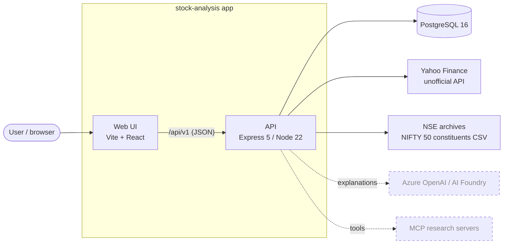
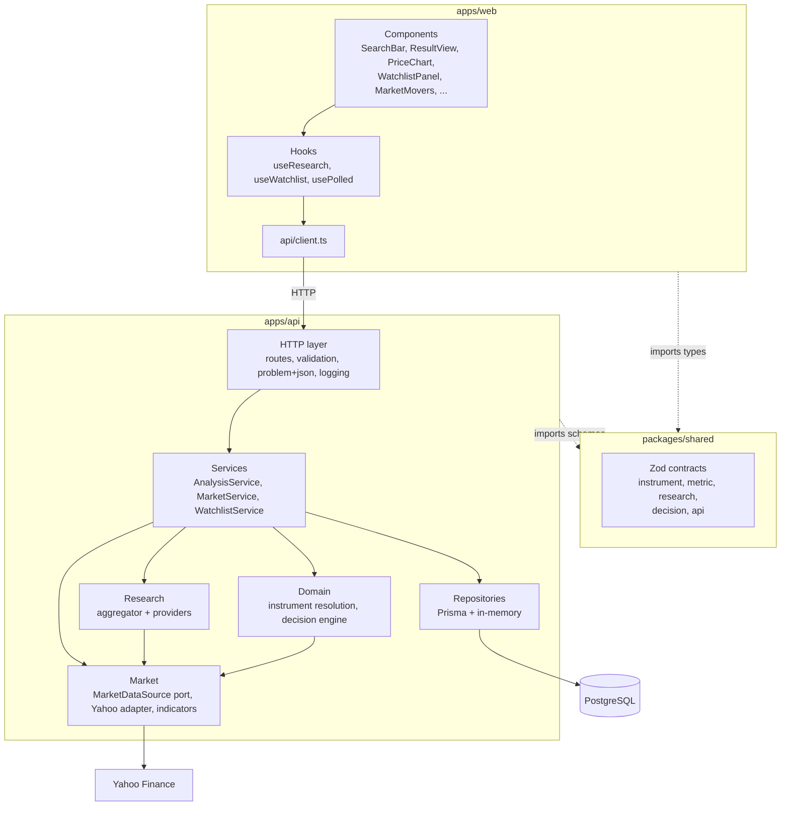
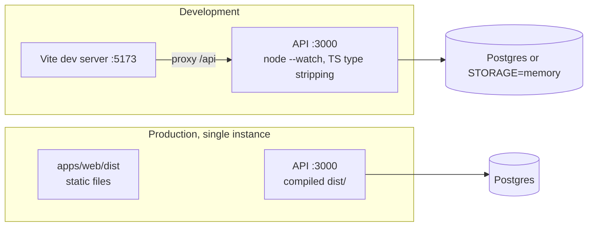
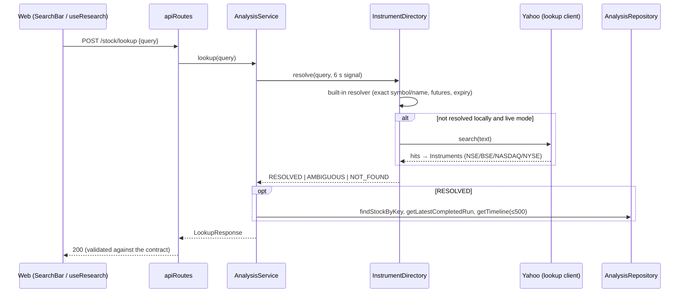
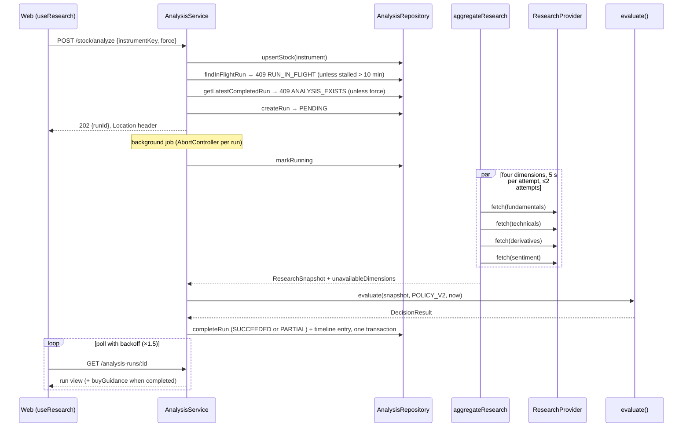
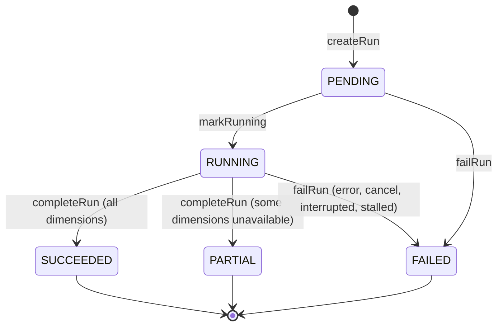
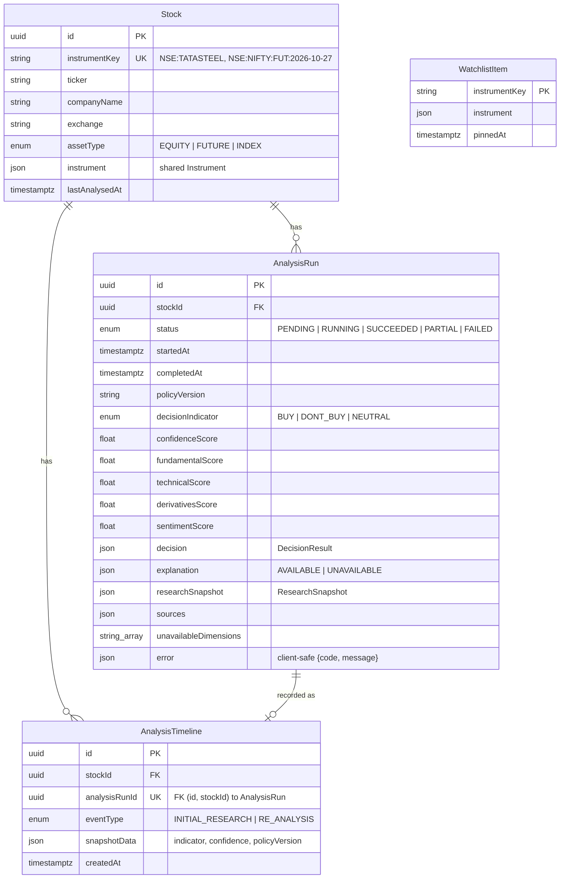

# Architecture (as built)

This document describes the system as it exists in the code today. `requirements.md` is the original spec (what
was asked for); `implementation-plan.md` records the validated decisions, phase order, and progress ledger. Where
this document and the code disagree, the code wins: please fix this document.

- **Part 1, High-level design (HLD):** context, components, deployment, cross-cutting concerns.
- **Part 2, Low-level design (LLD):** modules, request flows, the run lifecycle, the data model, contracts, and
  the decision engine.

Status legend: **Built**, **Planned** (in `implementation-plan.md`, not in the code yet).

---

# Part 1: High-level design

## 1.1 Purpose and principles

A research app for Indian (NSE/BSE) and US (NASDAQ/NYSE) stocks, indices, and index futures. A user searches for an
instrument; the API collects research data, and a **deterministic, versioned rule set** rates it BUY, DON'T BUY,
or NEUTRAL with sourced reasons, a confidence score, and a risk-to-reward estimate.

Design principles that shape everything below:

1. **The LLM never decides.** The indicator comes only from `evaluate()` (pure TypeScript). A future LLM may only
   explain a decision that already exists (`.claude/rules/decision-engine.md`).
2. **Reproducible decisions.** Every run stores the research snapshot it was decided from and the policy version.
   Same snapshot + same policy → same decision.
3. **Missing data is explicit.** Every metric is `OK`, `MISSING`, `NOT_APPLICABLE`, or `ERROR`. Missing data lowers
   confidence and can block BUY; it never silently counts as a pass.
4. **Contracts at every boundary.** Zod schemas in `packages/shared` validate API input, API output, provider output,
   and JSON read from the database.
5. **Ports and adapters.** Storage, market data, and research sources sit behind interfaces, so tests run without a
   network or database and vendors can be swapped.

## 1.2 System context



| External system      | Used for                                                                  | Status  |
| -------------------- | ------------------------------------------------------------------------- | ------- |
| PostgreSQL           | stocks, analysis runs, timeline, watchlist                                | Built   |
| Yahoo Finance        | instrument search, quotes, daily/intraday bars, statements, valuation, news | Built   |
| NSE archives         | NIFTY 50 constituent list for top movers (cached 12 h, snapshot fallback) | Built   |
| Azure OpenAI         | natural-language explanation of an existing decision (Phase 11)           | Planned |
| MCP servers          | web search, filings, F&O, pledging, FII/DII flows (Phase 7b / 12)         | Planned |
| M365 Agents SDK      | Teams/M365 channel (optional Phase 13)                                    | Planned |

## 1.3 Containers and components



| Component                     | Responsibility                                                                            |
| ----------------------------- | ----------------------------------------------------------------------------------------- |
| `packages/shared`             | the single definition of every request, response, and domain shape (Zod + inferred types) |
| `apps/api` HTTP layer         | request context and logging, input validation, response validation, RFC 9457 errors       |
| `AnalysisService`             | search, lookup, starting background analyses, run status, recovery, graceful shutdown    |
| `MarketService`               | top movers, chart bars, live quotes (live mode only)                                      |
| `WatchlistService`            | pin/unpin and the enriched watchlist (live price + latest signal)                         |
| Instrument directory          | resolves free text to one instrument: built-in list first, then the web                  |
| Research aggregator           | fetches the four research dimensions in parallel with timeouts, retries, and validation  |
| Decision engine               | pure `evaluate(snapshot, policy, now)` → `DecisionResult`                                 |
| Repositories                  | persistence ports with Prisma (Postgres) and in-memory implementations                   |
| `apps/web`                    | single-page UI; polls run status; no business rules beyond display                       |

## 1.4 Runtime and deployment



- **One API process per database.** Analyses run in-process, and startup marks every in-flight run as FAILED
  (`INTERRUPTED`). Replicas need run ownership (instance id + lease) first; that is Phase 14.
- **Modes** (env): `STORAGE=postgres|memory`, `RESEARCH_PROVIDER=live|fixture`. Fixture mode uses seeded synthetic
  data for the built-in instrument list and disables the market endpoints (503).
- **Graceful shutdown:** on SIGTERM/SIGINT the server stops accepting connections, cancels running analyses
  (recorded `ANALYSIS_CANCELLED`), disconnects Prisma, and exits; it force-exits after 10 s.
- **Not built yet:** Docker images, compose, and serving the web build from the API. They are deferred to the
  final hardening phase (see `implementation-plan.md`). CI (`.github/workflows/ci.yml`) runs format, lint,
  typecheck, unit tests, and build; Postgres integration tests run locally only.

## 1.5 Cross-cutting concerns

| Concern        | Approach                                                                                                   |
| -------------- | ---------------------------------------------------------------------------------------------------------- |
| Validation     | Zod on request input (400 with field errors), on every response before sending, on provider output, and on JSON read from the DB |
| Errors         | `application/problem+json` with `requestId`; client-safe messages only; internal detail goes to logs     |
| Logging        | pino JSON logs; request serializer is an allowlist (no headers, query strings, or IPs); secret paths redacted |
| Configuration  | `config/env.ts` validates the environment at startup; invalid config exits 1 naming the variable, never its value |
| Timeouts       | 6 s for interactive lookups and market calls; 5 s per research dimension attempt; 10 min stalled-run cutoff |
| Resilience     | bounded retries with jittered backoff for retryable vendor errors; partial research instead of failure; separate Yahoo clients (own queues) for lookup, research, and UI polling |
| Caching        | in-process: Yahoo responses (bounded LRU-style map, 500 entries), NIFTY 50 constituents (12 h)           |
| Security       | no auth yet (single-user app); body limit 100 kB; `x-powered-by` off; no secrets in the repo              |
| Compliance     | not investment advice; Yahoo data is for personal, non-commercial use; SEBI classification unresolved     |

## 1.6 Key decisions and trade-offs

| Decision                                                  | Why                                                                         | Cost                                                    |
| --------------------------------------------------------- | --------------------------------------------------------------------------- | ------------------------------------------------------- |
| Deterministic engine, LLM for explanation only            | auditable, reproducible, testable to 100% branch coverage                    | rules must be hand-written and versioned               |
| Background run + polling (202 then GET)                   | research takes seconds; HTTP stays fast; simple for the UI                   | needs run states, stall detection, and recovery       |
| In-process jobs, no queue                                 | smallest working design for one instance                                    | single instance only until Phase 14                     |
| Yahoo Finance as first live source                        | free, covers all four exchanges                                             | unofficial; no Indian F&O, pledging, or FII/DII flows (Indian stocks cap at NEUTRAL) |
| JSON columns for decision/snapshot + duplicated score columns | contracts evolve without migrations; listing queries stay indexed          | JSON must be validated on read                         |
| Microsoft agent packages deferred                         | `@microsoft/agents-bot-builder` doesn't exist on npm; Agent Framework JS is beta | spec's agent orchestration is not present yet         |

---

# Part 2: Low-level design

## 2.1 Repository layout

```text
packages/shared/src/
  common.ts        IsoDateTime, IsoDate, Score, Percent0To100
  instrument.ts    Exchange, Instrument (equity | index | future), instrumentKey()
  metric.ts        Metric<T>: OK | MISSING | NOT_APPLICABLE | ERROR
  source.ts        Source, SourceId
  research.ts      Fundamentals, Technicals, Derivatives, Sentiment, ResearchSnapshot
  decision.ts      DecisionIndicator, DecisionFactor, RiskReward, DecisionResult
  api.ts           every request/response shape for /api/v1

apps/api/src/
  server.ts        composition root: env, logger, adapters, services, listen, shutdown
  app.ts           createApp(deps): Express app with no I/O (tests call it directly)
  config/env.ts    environment schema
  http/            requestContext, validate (parseRequest), AppError, errorHandler
  routes/          apiRoutes, marketRoutes, watchlistRoutes, health
  services/        analysisService, marketService, watchlistService
  domain/instruments/  fixtureInstruments, instrumentMaster, resolveInstrument, instrumentDirectory
  domain/decision/     policy, checks, evaluate, guidance
  research/        researchProvider (port), researchAggregator, marketResearchProvider, fixtureResearchProvider
  market/          marketData (port), yahooMarketData, symbols, indicators, indexConstituents, exchangeTime
  repositories/    analysisRepository + watchlistRepository ports, Prisma and in-memory implementations,
                   shared contract test suites (*.contract.ts)
  db/prisma.ts     Prisma client with the pg adapter
apps/api/prisma/   schema.prisma, migrations (incl. raw-SQL constraints)

apps/web/src/
  App.tsx          three-column layout (movers | research | watchlist + searched stocks)
  api/client.ts    typed fetch client; parses responses with shared schemas
  hooks/           useResearch (research state machine), useWatchlist, usePolled
  components/      SearchBar, ReAnalyzeModal, ResultView, DecisionBadge, MetricsGrid, RiskReward, WhenToBuy,
                   TimelineView, SourceList, PriceChart, MarketMovers, RecentStocks, WatchlistPanel, ...
```

## 2.2 Composition (dependency wiring)

`server.ts` is the only place that reads the environment and chooses implementations:

| Port                  | `STORAGE=postgres` / `RESEARCH_PROVIDER=live` | `STORAGE=memory` / `RESEARCH_PROVIDER=fixture` |
| --------------------- | --------------------------------------------- | ---------------------------------------------- |
| `AnalysisRepository`  | `PrismaAnalysisRepository`                    | `InMemoryAnalysisRepository`                   |
| `WatchlistRepository` | `PrismaWatchlistRepository`                   | `InMemoryWatchlistRepository`                  |
| `ResearchProvider`    | `MarketResearchProvider(YahooMarketData)`     | `FixtureResearchProvider`                      |
| `MarketDataSource`    | three `YahooMarketData` clients (lookup, research, UI) | none (market endpoints return 503)    |
| `DecisionPolicy`      | `POLICY_V2`                                   | `POLICY_V2`                                    |

Services receive their ports through constructor deps plus an injected `now()` clock, so every time-dependent rule
is testable.

## 2.3 Flow: search and lookup (spec step 1)



Resolution rules: partial input never auto-resolves ("hdfc" → candidates). A web result resolves only when the
intent is clear: a ticker-shaped input matching exactly one symbol, an exact company name, or a single web hit.
Futures and exchange-conflicting queries are resolved locally only. A failing web search degrades to built-in
results.

The UI then shows the result, the candidate list, "not found", or, when an analysis exists, `ReAnalyzeModal`
("view existing" or "run fresh re-analysis").

## 2.4 Flow: analysis (spec steps 2–4)



Failure handling inside the job:

| Where it fails                          | Outcome                                                     |
| --------------------------------------- | ----------------------------------------------------------- |
| one dimension throws, times out, or returns invalid data | that dimension becomes `ERROR` metrics; run is `PARTIAL` |
| abort during research (shutdown)        | `FAILED` with `ANALYSIS_CANCELLED`                          |
| anything else (engine, persistence)     | `FAILED` with `ANALYSIS_FAILED`; detail in the log only     |
| process died mid-run                    | next startup marks it `FAILED` with `INTERRUPTED`           |
| failure couldn't be recorded (DB down)  | the next read or analyze closes it as `STALLED` after 10 min |

## 2.5 Run lifecycle



Invariants (enforced by the repository and, in Postgres, by raw-SQL constraints in the migrations):

- At most one `PENDING`/`RUNNING` run per stock (partial unique index `AnalysisRun_one_in_flight_per_stock`).
- Decision columns are set only on `SUCCEEDED`/`PARTIAL`; `error` only on `FAILED`; `PARTIAL` ⇔ non-empty
  `unavailableDimensions` (allow-listed values). Scores are within 0–100; `completedAt ≥ startedAt`.
- Completing a run writes the run, one timeline entry, and `Stock.lastAnalysedAt` atomically. The complete view is
  validated against the `AnalysisRunView` contract **before** anything is written.

## 2.6 Data model



- The composite foreign key `(analysisRunId, stockId)` keeps a timeline entry on the same stock as its run.
- `WatchlistItem` is deliberately not tied to `Stock`: an instrument can be pinned before it is analysed. There
  are no user accounts, so there is one watchlist (max 50).
- Indexes: `Stock(companyName)`, `AnalysisRun(stockId, startedAt DESC)`, `AnalysisTimeline(stockId, createdAt)`,
  `WatchlistItem(pinnedAt)`.
- Migrations: `init`, `tighten_run_checks`, `watchlist` (`apps/api/prisma/migrations`).

## 2.7 Research model

A `ResearchSnapshot` (versioned by `schemaVersion`) holds the instrument, `asOf`, the cited `sources`, and four
sections. Every field is a `Metric`:

| Status           | Meaning                                                     | Effect on the engine                    |
| ---------------- | ----------------------------------------------------------- | --------------------------------------- |
| `OK`             | value with `sourceId` and `observedAt`                      | usable if fresh (per-section max age)   |
| `MISSING`        | the source doesn't carry it                                 | check is UNAVAILABLE; lowers confidence; blocks BUY if required |
| `NOT_APPLICABLE` | the concept doesn't exist here (e.g. pledging for US stocks) | check is skipped                        |
| `ERROR`          | the provider failed for this dimension                      | same as MISSING; run is PARTIAL         |

| Section      | Examples                                                          | Live source today                                 |
| ------------ | ----------------------------------------------------------------- | ------------------------------------------------- |
| fundamentals | revenue growth, margins, P/E, P/S, D/E, ROE, ROCE, promoter pledge | Yahoo statements + valuation (TTM); India-only fields MISSING |
| technicals   | last price, EMA20/50/200, RSI14, ATR14, volume ratio, divergence, breakout | computed from Yahoo daily bars (`market/indicators.ts`) |
| derivatives  | OI build-up, basis                                                | not connected (MISSING / NOT_APPLICABLE)          |
| sentiment    | news, FII/DII flows, bulk/block deals                             | Yahoo news; flows not connected                  |

The aggregator treats provider output as **untrusted**: it parses each section with the shared schema, rejects
sources that collide across dimensions or aren't cited correctly, and enforces its own timeout even when a provider
ignores its `AbortSignal`. Only `RetryableProviderError` is retried. Methodology and formulas:
`docs/decision-policy-v2.md`.

## 2.8 Decision engine

`evaluate(snapshot, policy, now)` in `apps/api/src/domain/decision/evaluate.ts`. Pure: no I/O, no randomness.

1. Validate the snapshot (`ResearchSnapshot.parse`).
2. Run every check registered for the policy version (`checks.ts`). Each check is `PASS`, `FAIL`, `UNAVAILABLE`,
   or `NOT_APPLICABLE` (e.g. India-only checks for US listings). A check is flagged `veto`, `requiredForBuy`, and/or
   `scored`, and belongs to a section.
3. Indicator:
   - any applicable veto `FAIL` → **DONT_BUY**
   - else at least one applicable BUY criterion and every BUY criterion and veto `PASS` → **BUY**
   - else → **NEUTRAL**
4. Subscores per section: 100 × passing / applicable scored checks (null if none apply).
5. Confidence = completeness (usable / applicable checks) × strength, where strength is the mean subscore for BUY,
   `neutralBase` for NEUTRAL, and `vetoBase + vetoStep × failedVetoes` for DONT_BUY.
6. Risk-to-reward from ATR14 (stop 2×ATR, target 4×ATR; a tighter EMA50 support stop when available).
7. Reasons (PASS) and risk factors (FAIL, then UNAVAILABLE), each citing source ids.

`DecisionPolicy` (`policy.ts`) holds every threshold. Released versions are frozen; a change means a new version so
historical runs stay reproducible. `buyGuidance()` (`guidance.ts`) derives "what would make this a BUY" from a
stored decision and is attached to completed runs on read. Full rules: `docs/decision-policy-v1.md` and
`docs/decision-policy-v2.md`.

## 2.9 API contracts

All shapes are in `packages/shared/src/api.ts`. Routes are thin: `parseRequest(schema, input)` → service call →
`Schema.parse(result)` → send.

| Method | Path                         | Request                      | Response                                                | Errors                     |
| ------ | ---------------------------- | ---------------------------- | ------------------------------------------------------- | -------------------------- |
| GET    | `/healthz`                   | —                            | 200                                                     | —                          |
| GET    | `/readyz`                    | —                            | 200 when the DB answers `SELECT 1`                      | 503                        |
| GET    | `/api/v1/stock/search`       | `?q=`                        | `SearchResponse` (≤10 candidates)                       | 400 (web search failure degrades to built-in results) |
| POST   | `/api/v1/stock/lookup`       | `LookupRequest {query}`      | `LookupResponse` (NOT_FOUND / AMBIGUOUS / RESOLVED + existing) | 400 (degrades like search) |
| POST   | `/api/v1/stock/analyze`      | `AnalyzeRequest {instrumentKey, force?}` | 202 `AnalyzeAccepted {runId}`               | 404, 409 `ANALYSIS_EXISTS` / `RUN_IN_FLIGHT`, 503 (market source down or shutting down) |
| GET    | `/api/v1/analysis-runs/:id`  | uuid                         | `AnalysisRunView` (+ `buyGuidance`)                     | 400, 404                   |
| GET    | `/api/v1/stocks`             | —                            | `AnalysedStocks` (≤100)                                 | —                          |
| GET    | `/api/v1/market/movers`      | —                            | `MarketMovers` (NIFTY 50 top 10 up/down)                | 503                        |
| GET    | `/api/v1/market/chart/:key`  | `?interval=5m\|1d`           | `PriceChart` (OHLCV bars)                               | 404, 503                   |
| GET    | `/api/v1/market/quote/:key`  | —                            | `LiveQuote`                                             | 404, 503                   |
| GET    | `/api/v1/watchlist`          | —                            | `Watchlist` (live price + latest signal)                | —                          |
| PUT    | `/api/v1/watchlist/:key`     | —                            | `Watchlist` (idempotent)                                | 404, 409 `WATCHLIST_FULL`  |
| DELETE | `/api/v1/watchlist/:key`     | —                            | `Watchlist` (idempotent)                                | —                          |

Errors are `application/problem+json`: `{type, title, status, detail, instance, requestId, code?, runId?, errors?}`.

## 2.10 Web UI

- `useResearch` is a reducer-driven state machine with exactly one state at a time: `idle`, `looking-up`,
  `not-found`, `ambiguous`, `confirm` (existing analysis), `analyzing` (STARTING → PENDING → RUNNING), `result`,
  `run-failed`, `error`. Requests are abortable; a new search cancels the old one; stale responses are ignored;
  polling backs off ×1.5 and tolerates transient errors up to a ceiling.
- `api/client.ts` parses every response with the shared schemas and maps problem+json to `ApiError`.
- Layout: movers (left), search + chart + result (centre), watchlist and searched stocks (right). On phones the
  order is research → watchlist/searched → movers; side panels are collapsible.
- The UI never computes a decision; it renders `DecisionResult`, `buyGuidance`, and sources from the API.

## 2.11 Testing

| Layer                | What                                                               | Command            |
| -------------------- | ------------------------------------------------------------------ | ------------------ |
| shared               | contract parsing and cross-field rules                             | `npm test`         |
| decision engine      | rules, vetoes, confidence, risk-to-reward (100% branch coverage)   | `npm test`         |
| research / market    | aggregator timeouts, retries, cancellation, validation; indicators; Yahoo adapter with recorded shapes | `npm test` |
| repositories         | one contract suite run against in-memory (unit) and Postgres (int) | `npm test`, `npm run test:int` |
| API                  | routes via `createApp` with fakes                                  | `npm test`         |
| web                  | components and hooks with React Testing Library + MSW              | `npm test`         |

No test uses the network. Postgres integration tests need `DATABASE_URL_TEST` (a database ending in `_test`) and run
locally only.

## 2.12 Planned extensions and where they plug in

| Planned                                  | Plug-in point                                                                        |
| ---------------------------------------- | ------------------------------------------------------------------------------------ |
| LLM explanation (Phase 11)               | after `evaluate()` in `AnalysisService.#execute`; writes `explanation` (currently always `UNAVAILABLE`); must cite only run sources and can't change the indicator |
| MCP research client (Phase 7b / 12)      | a new `ResearchProvider` (or one per dimension) behind the existing aggregator      |
| Indian F&O, pledging, FII/DII flows      | providers filling `derivatives` / `sentiment` metrics; no engine change needed       |
| Multi-instance (Phase 14)                | run ownership (instance id + lease) replacing startup recovery of all in-flight runs |
| Docker / compose (Phase 14)              | packaging only; no code changes expected                                             |
| M365 Agents SDK channel (Phase 13)       | a separate adapter calling `AnalysisService`, not the engine                         |
